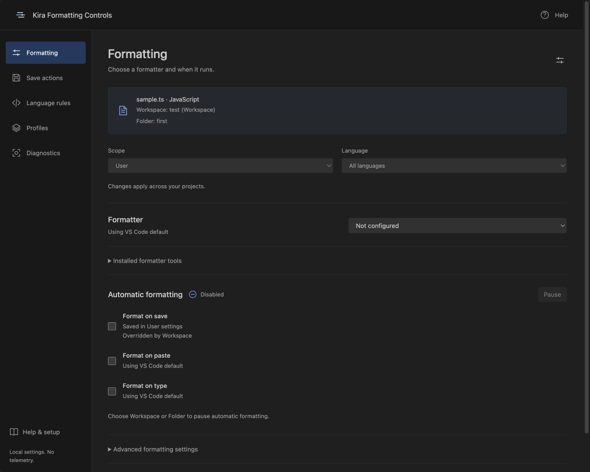
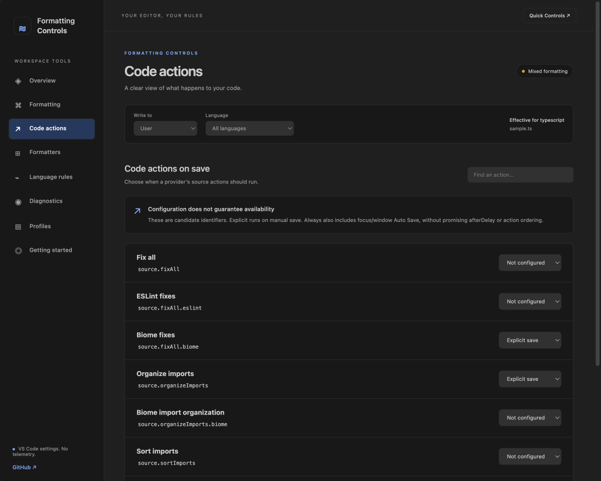
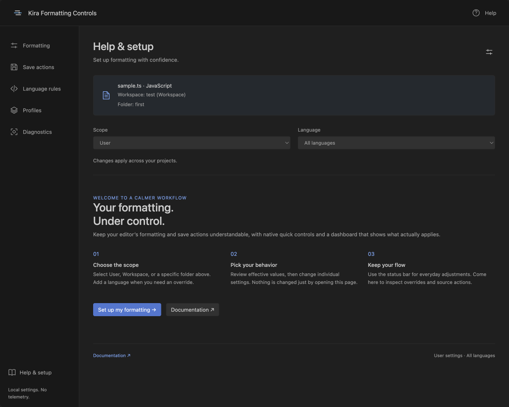
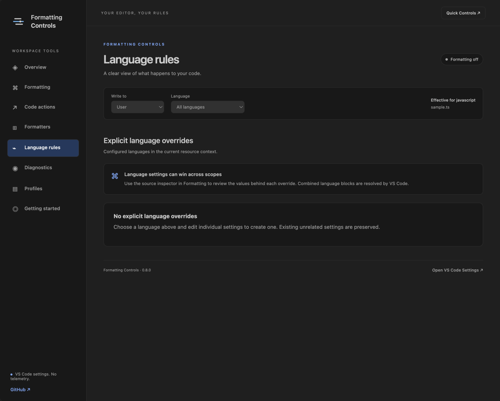
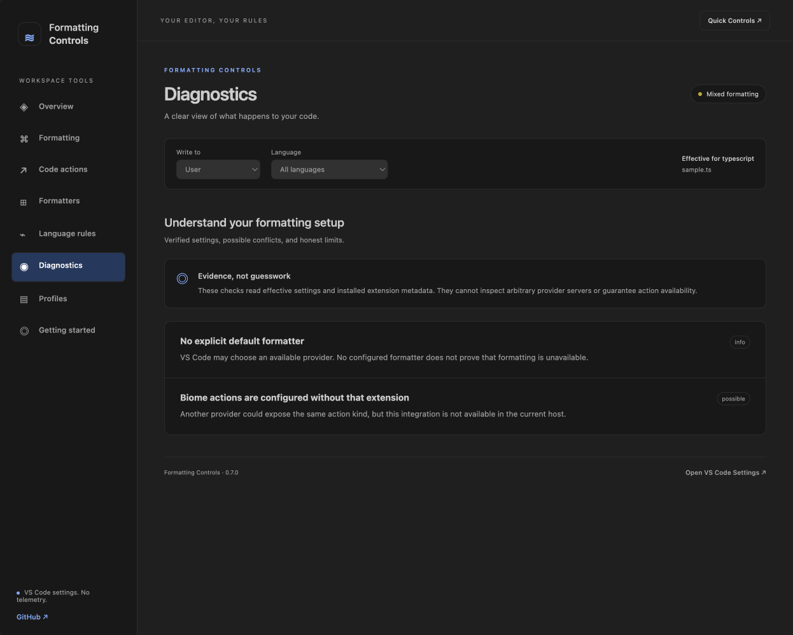
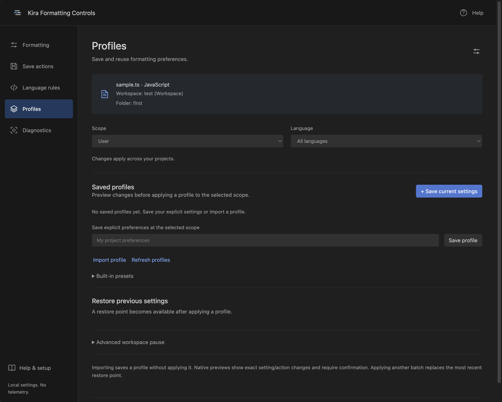
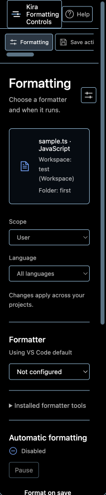
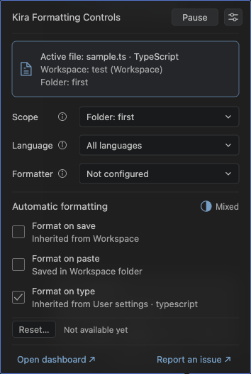

# Kira Formatting Controls

**Make every save work your way.**

[](https://github.com/kira-explore/formatting-controls/actions/workflows/ci.yml) [](https://github.com/kira-explore/formatting-controls/blob/main/LICENSE) [](https://code.visualstudio.com/) [](https://nodejs.org/) [](https://bun.sh/) [](https://www.typescriptlang.org/) [](https://biomejs.dev/)

A control center for VS Code formatting, save actions and language settings. Read effective settings from the status bar, pause automatic formatting, or open the dashboard to choose a formatter, manage source actions and understand which settings apply.

Hover or click the status bar to open the same **Kira Formatting Controls** card. Its checkbox and dropdown displays are read-only; use **Open dashboard** or the **Quick Controls** command to edit settings. Click pins the card; Escape dismisses it.



## What you can do

- **Keep a clear summary at the status bar.** Read formatting, scope, source notes and formatter details. Pause/Resume appears in the header before Settings and preserves save actions. Formatting values remain read-only; long context names reveal their full labels on hover.
- **Pause through native commands.** Pause/Resume opens a native picker before changing settings. The hover card closes first, avoiding live-update flicker. The same action is available from the Command Palette; Escape cancels it.
- **See the effective state.** The status bar shows ON when any of Format on Save, Paste or Type is enabled and OFF when all three are disabled. The card distinguishes fully enabled, disabled and mixed settings.
- **Choose where changes belong.** Write to User, Workspace, or a specific workspace folder. Select a VS Code language ID for language overrides.
- **Configure formatting and saving.** Toggle formatting triggers, select the save formatting mode, choose a default formatter, and configure Auto Save and its delay.
- **Manage save actions individually.** Set a source action to explicit save, always, or never while preserving unrelated entries at the selected scope.
- **Inspect overrides.** Compare values at your chosen scope with effective values and inspect the configuration sources exposed by VS Code.
- **Explain the setup.** Diagnostics distinguishes verified setting facts from possible provider conflicts. Language Rules shows explicit overrides.
- **Reuse your preferences.** Save named profiles, import/export JSON, and preview changes before applying them. Restore only values that remain unchanged.
- **Pause at a project scope.** Pause only formatting through the status card, or include configured save actions through Profiles. Both use a durable recovery record and an explicit Resume action.
- **Reset deliberately.** Preview the selected setting before removing its value at that scope. A changed preview is rejected.

The Marketplace display name is **Kira Formatting Controls**; the stable extension ID remains `rajudhami.formatting-controls`.

No telemetry, remote analytics, or source-code transmission. Settings stay in VS Code. Opening the dashboard or welcome page changes no formatting preferences.

## Dark theme previews

Screenshots show version **0.9.0** in VS Code’s **Dark Modern** theme. Formatting opens first. Five main sections share file context and scope selection, with Help & setup available separately.

<details>
<summary>Code actions on save</summary>



</details>

<details>
<summary>Help & setup</summary>



</details>

<details>
<summary>Language rules</summary>



</details>

<details>
<summary>Diagnostics and confidence levels</summary>



</details>

<details>
<summary>Profiles, presets and temporary pause</summary>



</details>

<details>
<summary>Narrow layout and high-contrast theme</summary>



</details>

## Try the development build

Formatting Controls is in active development and has not been published to the Marketplace. The publisher is [`rajudhami`](https://marketplace.visualstudio.com/publishers/rajudhami); the extension identifier is `rajudhami.formatting-controls`.

Requires **VS Code 1.140 or newer**. For local development, use **Node 24 LTS** and the Bun version declared in `package.json`.

```sh
git clone https://github.com/kira-explore/formatting-controls.git
cd formatting-controls
bun install --frozen-lockfile
bun run build
```

Open the folder in VS Code and press **F5** to launch the Extension Development Host. Or create an installable preview:

```sh
bun run package
```

In VS Code, run **Extensions: Install from VSIX…** and select `formatting-controls-0.9.0.vsix`. A successful GitHub Actions run also provides the VSIX artifact. No Marketplace credentials are required.

## Find your flow

Hover the status-bar item to open the anchored **Kira Formatting Controls** card. Click it to focus and keep that same card open above the status bar; no docked panel or editor tab is created. Its checkbox and dropdown displays are read-only. Open the dashboard for edits, save actions and advanced workflows, or use the optional native Quick Controls command. Command Palette entries:

| Command                                                      | Purpose                                                              |
| ------------------------------------------------------------ | -------------------------------------------------------------------- |
| **Formatting Controls: Open Dashboard**                      | Open the full settings dashboard                                     |
| **Formatting Controls: Quick Controls**                      | Optional formatting-only native picker                               |
| **Formatting Controls: Pause / Resume Automatic Formatting** | Confirm a formatting-only project pause or resume in a native picker |
| **Formatting Controls: Native Quick Controls**               | Edit a setting using the original native pickers                     |
| **Formatting Controls: Inspect Effective Settings**          | Open a JSON report of effective values and scope sources             |
| **Formatting Controls: Restore Previous Settings**           | Restore untouched values from the latest batch in this workspace     |
| **Formatting Controls: Getting Started**                     | Reopen the welcome page                                              |

Help & setup appears once on first activation. Its four-step guide covers scope, language, formatter and formatting triggers. Common questions open one answer at a time and link to Diagnostics or Save actions. The footer links to documentation and the GitHub issue form.

The blue status icon and label align together at the right of **Automatic formatting** and summarize the three formatting triggers: a circled checkmark for **Enabled**, a circle minus for **Disabled**, and a half-filled circle for **Mixed**. The file box keeps its text-document icon and full text column without a duplicate state label. The status bar uses ON when any trigger is enabled and OFF when all are disabled; the card’s accessible description retains the three-state summary. Active-file labels use full language names. The card keeps a fixed 330px content width; exceptionally long names use ellipses, with full names available on hover. **Scope**, **Language** and **Formatter** appear above Automatic formatting. The text-only Pause/Resume button sits in the header immediately before Settings; the footer opens the dashboard or a new GitHub issue. The status-card screenshot below shows version 0.9.0. [Status-card details and API limits](docs/status-controls.md).



Hover the information icons beside **Scope**, **Language** and **Formatter** to see where changes apply and which settings supply the formatter. These icons have no click action. Confirmed formatter problems or a failed Pause/Resume action add a compact warning; **Review in dashboard** opens Diagnostics with the card’s file and scope ready to inspect. Select **Run diagnostics** to check the current settings. Saving a blocked settings file or successfully retrying clears the corresponding failure warning. Leaving the default formatter unconfigured does not cause a warning.

### Dashboard

| Section            | What it shows                                                                                                    |
| ------------------ | ---------------------------------------------------------------------------------------------------------------- |
| **Formatting**     | Formatter selection, installed tools, automatic formatting, Pause/Resume and advanced settings/source inspection |
| **Save actions**   | Auto Save, delay, common source actions, provider-specific actions and custom entries                            |
| **Language rules** | Explicit language overrides, their sources and an entry point to add or edit a rule                              |
| **Profiles**       | Presets, named profiles, import/export, preview/apply and recovery                                               |
| **Diagnostics**    | On-demand findings, grouped setting sources and workspace run history                                            |
| **Help & setup**   | Four setup steps, expandable common questions, documentation and issue reporting                                 |

Choose **Scope** and **Language** before changing a control. Values are effective for the selected language, or the last active file’s language when All languages is selected. Each change writes only to the selected scope. An override may keep the effective value unchanged; source notes explain why.

For multi-root projects, choose **Folder: name** explicitly. Auto Save is disabled while editing language-specific settings. Formatter tools and advanced controls are expandable inside Formatting. Auto Save and provider-specific source actions are grouped in Save actions.

The status card’s **Reset** placeholder is disabled and marked **Not available yet**. Existing per-setting dashboard resets under advanced controls remove the selected override.

### Formatting and source actions are separate

The status bar and card icons summarize only the three built-in formatting flags. It does not promise that a formatter is available or that code actions will execute.

| Source-action value | Behavior                                  |
| ------------------- | ----------------------------------------- |
| `explicit`          | Run on explicit saves                     |
| `always`            | Also run on focus/window-change Auto Save |
| `never`             | Do not run on save                        |

`always` does not promise execution on `afterDelay` Auto Save or a particular action order. Action IDs depend on the provider and language. Legacy action arrays must be migrated through VS Code Settings before editing them here.

The formatter list is a set of known integrations, not a complete provider registry. Extension presence cannot prove that it is enabled, configured, or eligible for your file. You can enter another formatter’s `publisher.extension` ID in Formatting.

## Profiles and temporary pause

Choose a scope and optional language first. **Save profile** captures only explicit values at that scope. Presets include Minimal, Strict, Formatting Only and Project Default; Project Default requires explicit project preferences. **Preview & apply** opens a JSON change preview and a native confirmation picker. Source-action entries merge with the selected scope, preserving unrelated entries.

**Import JSON** saves a validated version 1 profile without applying it. **Export** uses a native file picker. Profile files contain formatting preferences, not workspace paths. Language-specific profiles require selecting the same language before applying.

**Preview temporary pause** is available for Workspace and Workspace Folder. It changes real formatting flags and currently configured actions at that scope. Higher-priority overrides may still run. Pause persists until **Resume / restore**, including after reloads; a recovery reminder appears when needed. User-wide pause is unavailable because it could affect other windows.

Restore preserves externally edited settings and newly added actions. If conflicts remain, review them in Profiles or choose **Keep current values** to discard the remaining restore point. The Command Palette's **Formatting Controls: Restore Previous Settings** works without the dashboard open. Restore points belong to the workspace/window where the batch was applied; saved custom profiles are shared across workspaces.

Settings APIs are not atomic transactions. Concurrent edits between checking and writing cannot be perfectly isolated. See the [workflow and recovery limits](docs/workflows.md).

## Release readiness

The development VSIX can be installed locally. PR and release checks require a clean dependency audit and verified packaging. [Remote SSH](docs/remote-workspace.md) and [two-window](docs/multi-window.md) reviews cover their documented scenarios; WSL and Dev Containers connections remain untested. Hands-on screen-reader review and maintainer approval are still required before publication. See [release preparation](docs/releasing.md), [security](SECURITY.md) and [support](SUPPORT.md). No automatic Marketplace publication is configured.

## Development

**Package manager:** Bun 1.4.4 with a committed `bun.lock`. **Node.js:** use the latest patch of Node 24 LTS for development. CI, Node type declarations and host/test bundle targets use the 24.x line. Tool versions are declared in `package.json`.

All authored scripts use TypeScript and ES imports. The dashboard uses React and Vite; Biome handles formatting, linting, and import organization. The extension host is bundled separately, and dashboard assets load only when requested.

```sh
bun run typecheck       # Host and dashboard types
bun run lint            # Biome checks
bun run format          # Apply formatting and safe fixes
bun run test            # Pure configuration and protocol tests
bun run test:integration # Real VS Code, isolated user data and two workspace folders
bun run package         # Build and package the VSIX
```

For dashboard changes, edit `webview-ui/src`, run `bun run build`, and run **Developer: Reload Window** in the Extension Development Host. The dashboard uses VS Code’s real message bridge; no development server is embedded in the extension.

Read the [architecture and feature matrix](docs/architecture.md), [validation notes](docs/validation.md), and [contribution guide](CONTRIBUTING.md). We use Conventional Commits and short-lived branches with pull requests into `main`.

## Documentation

- [Architecture](docs/architecture.md)
- [Status card and read-only controls](docs/status-controls.md)
- [Profiles, pause and recovery](docs/workflows.md)
- [Validation commands and coverage](docs/validation.md)
- [Release preparation](docs/releasing.md)

Have a reproducible problem or a focused idea? [Open an issue](https://github.com/kira-explore/formatting-controls/issues/new/choose).

## License

[MIT](LICENSE) © 2026 [Raju Dhami](https://github.com/Raju). Bundled UI dependencies retain their [third-party notices](THIRD_PARTY_NOTICES.md).
