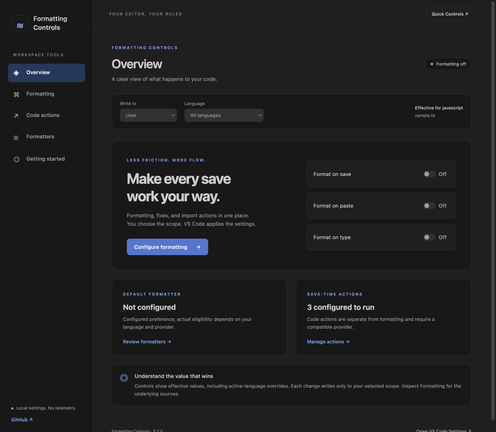
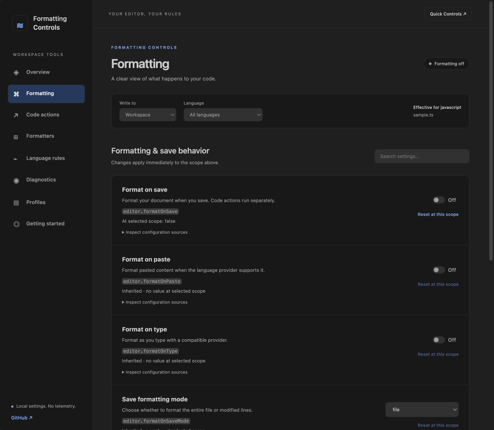
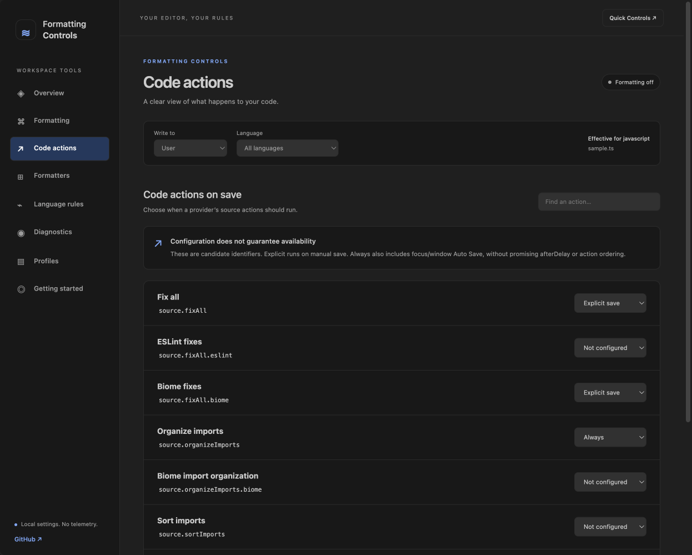
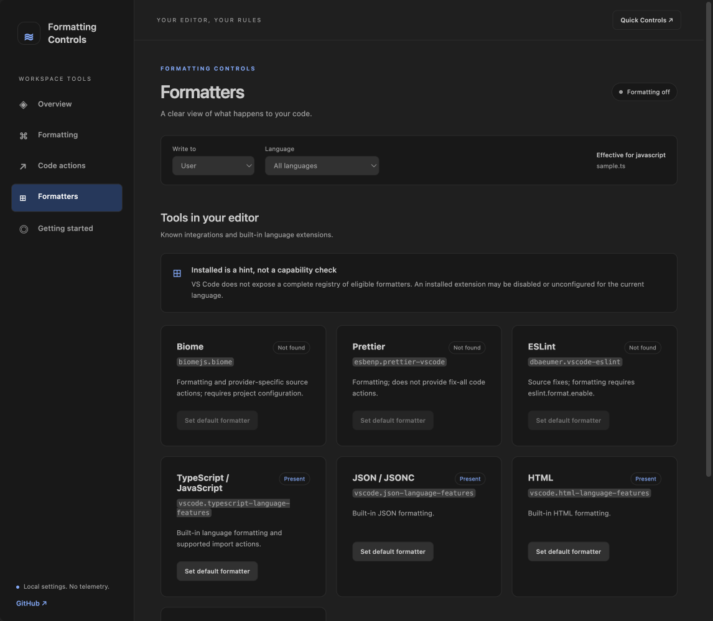
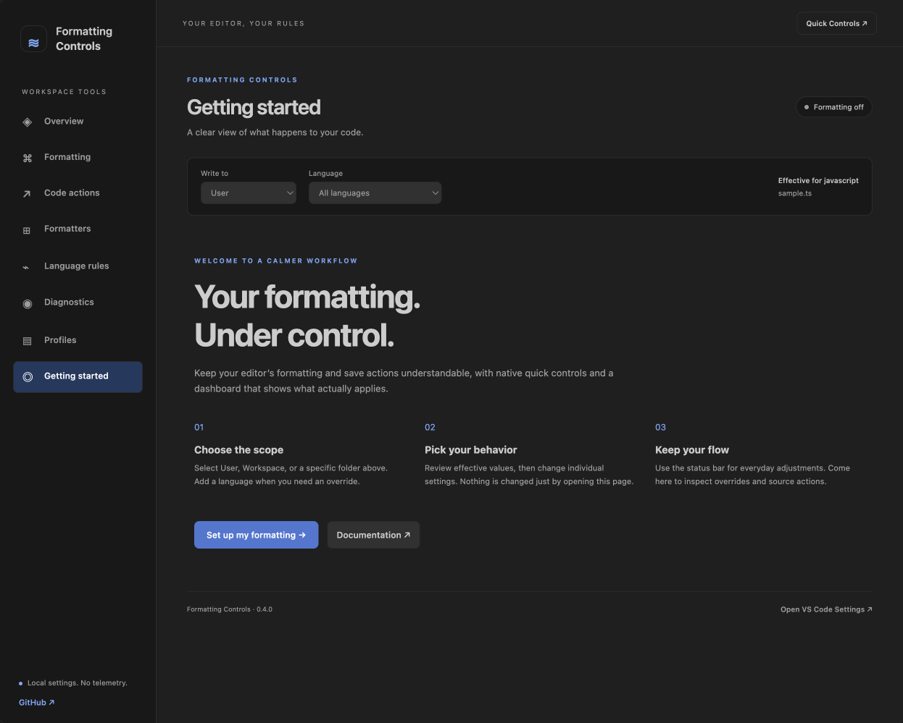
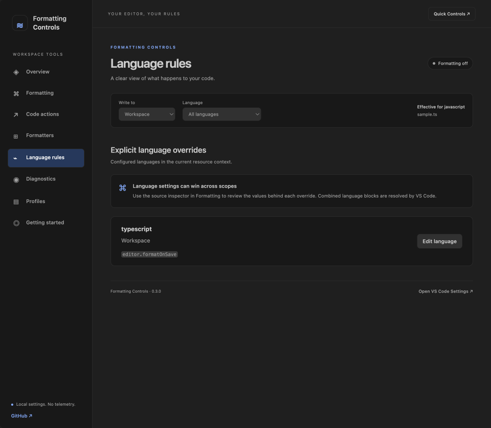
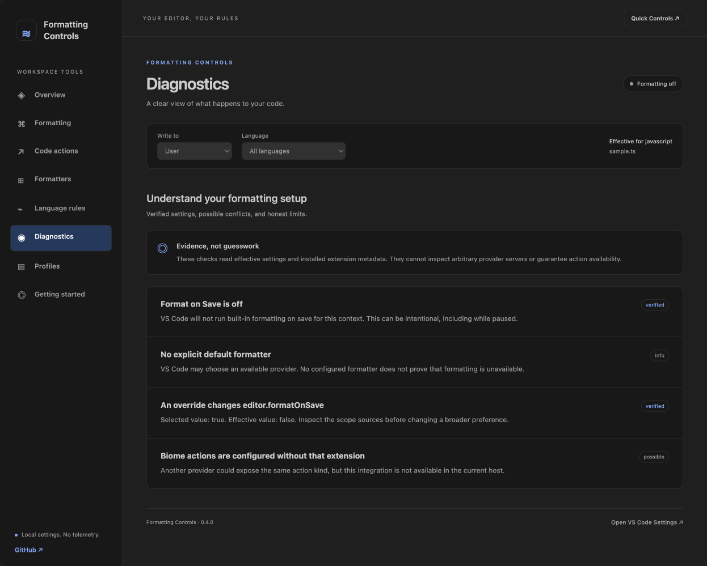
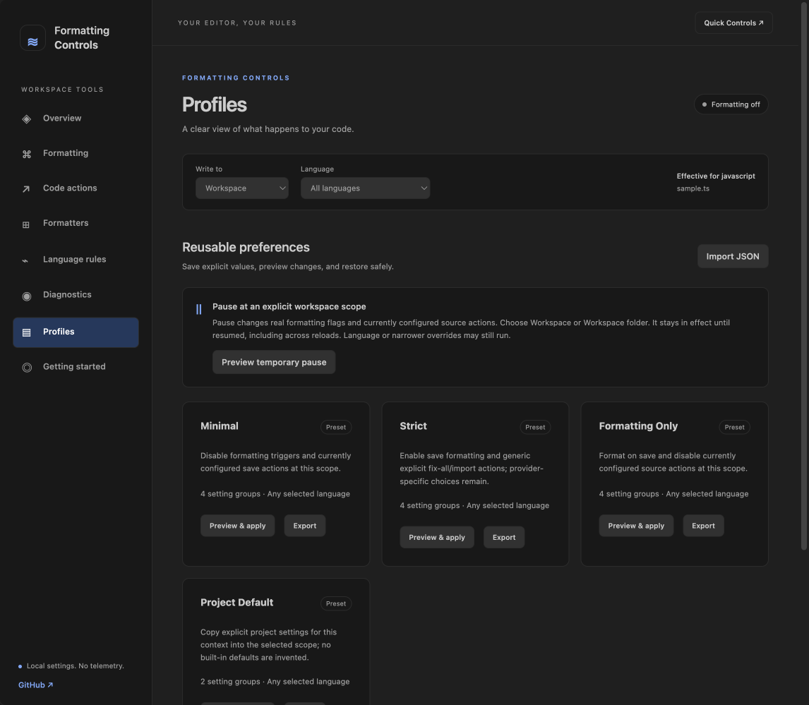
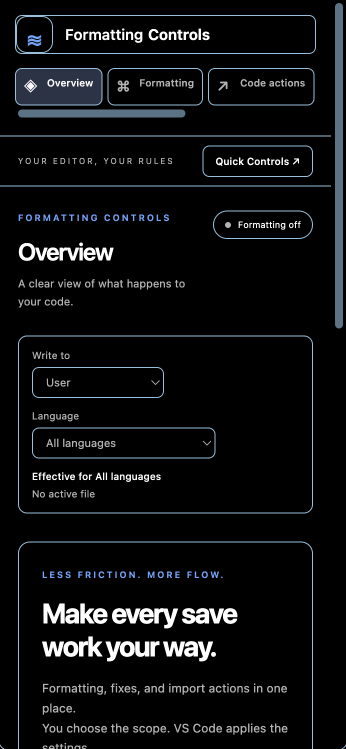
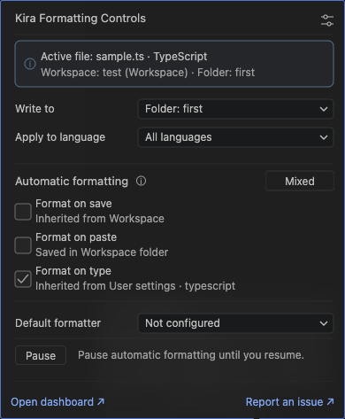

# Kira Formatting Controls

**Make every save work your way.**

[](https://github.com/kira-explore/formatting-controls/actions/workflows/ci.yml) [](https://github.com/kira-explore/formatting-controls/blob/main/LICENSE) [](https://code.visualstudio.com/) [](https://nodejs.org/) [](https://bun.sh/) [](https://www.typescriptlang.org/) [](https://biomejs.dev/)

A control center for VS Code formatting, save actions, and language settings. Make quick adjustments from the status bar, or open the dashboard to choose a formatter, manage source actions, and understand which settings apply.

**Status card in regular VS Code:** hover and click open the same **Kira Formatting Controls** card; click pins it. The header has a compact Settings icon. A fixed **Enabled / Disabled / Mixed** badge summarizes the always-visible, read-only checkboxes. **Pause / Resume** retains your previous configuration; only its button is clickable, with an explanation beside it. The footer opens the dashboard or this repository’s issue form. Edit individual settings in the dashboard or through **Formatting Controls: Quick Controls**.



## What you can do

- **Keep a clear summary at the status bar.** Hover to open the anchored card; click to pin the same card. Read effective formatting, scopes, source notes and formatter details. Use reviewed formatting-only Pause/Resume, or open the dashboard for individual changes.

- **See the effective state.** The status bar shows ON, OFF, or MIXED for Format on Save, Paste, and Type in the active editor.
- **Choose where changes belong.** Write to User, Workspace, or a specific workspace folder. Select a VS Code language ID for language overrides.
- **Configure formatting and saving.** Toggle formatting triggers, select the save formatting mode, choose a default formatter, and configure Auto Save and its delay.
- **Manage save actions individually.** Set a source action to explicit save, always, or never while preserving unrelated entries at the selected scope.
- **Inspect overrides.** Compare values at your chosen scope with effective values and inspect the configuration sources exposed by VS Code.
- **Explain the setup.** Diagnostics distinguishes verified setting facts from possible provider conflicts. Language Rules shows explicit overrides.
- **Reuse your preferences.** Save named profiles, import/export JSON, and preview changes before applying them. Restore only values that remain unchanged.
- **Pause at a project scope.** Temporarily disable formatting and configured save actions, with a durable recovery record and an explicit Resume action.
- **Reset deliberately.** Preview the selected setting before removing its value at that scope. A changed preview is rejected.

The Marketplace display name is **Kira Formatting Controls**; the stable extension ID remains `rajudhami.formatting-controls`.

No telemetry, remote analytics, or source-code transmission. Settings stay in VS Code. Opening the dashboard or welcome page changes no formatting preferences.

## Dark theme previews

Screenshots are captured from the running extension in VS Code’s **Dark Modern** theme. Overview is shown above; expand the sections below to see the other seven dashboard tabs.

<details>
<summary>Formatting controls and scope overrides</summary>



</details>

<details>
<summary>Code actions on save</summary>



</details>

<details>
<summary>Formatters and known integrations</summary>



</details>

<details>
<summary>Getting Started and welcome</summary>



</details>

<details>
<summary>Language rules and override sources</summary>



</details>

<details>
<summary>Diagnostics and confidence levels</summary>



</details>

<details>
<summary>Profiles, presets and temporary pause</summary>



</details>

<details>
<summary>Narrow layout and high-contrast theme</summary>



</details>

## Try the development build

Formatting Controls is in active development and has not been published to the Marketplace. The publisher is [`rajudhami`](https://marketplace.visualstudio.com/publishers/rajudhami); the extension identifier is `rajudhami.formatting-controls`.

Requires **VS Code 1.140 or newer**. For local development, use **Node 24 LTS** and the Bun version declared in `package.json`.

```sh
git clone https://github.com/kira-explore/formatting-controls.git
cd formatting-controls
bun install --frozen-lockfile
bun run build
```

Open the folder in VS Code and press **F5** to launch the Extension Development Host. Or create an installable preview:

```sh
bun run package
```

In VS Code, run **Extensions: Install from VSIX…** and select `formatting-controls-0.5.0.vsix`. A successful GitHub Actions run also provides the VSIX artifact. No Marketplace credentials are required.

## Find your flow

Hover the status-bar item to open the anchored **Kira Formatting Controls** card. Click it to focus and keep that same card open above the status bar; no docked panel or editor tab is created. Its checkbox and dropdown displays are read-only. Open the dashboard for edits, save actions and advanced workflows, or use the optional native Quick Controls command. See [surface details](docs/status-controls.md). Command Palette entries:

| Command                                             | Purpose                                                          |
| --------------------------------------------------- | ---------------------------------------------------------------- |
| **Formatting Controls: Open Dashboard**             | Open the full settings dashboard                                 |
| **Formatting Controls: Quick Controls**             | Optional formatting-only native picker                           |
| **Formatting Controls: Native Quick Controls**      | Edit a setting using the original native pickers                 |
| **Formatting Controls: Inspect Effective Settings** | Open a JSON report of effective values and scope sources         |
| **Formatting Controls: Restore Previous Settings**  | Restore untouched values from the latest batch in this workspace |
| **Formatting Controls: Getting Started**            | Reopen the welcome page                                          |

The welcome page appears once on first activation. It introduces the workflow and links to settings, documentation, and GitHub; it does not apply a preset automatically.

The card uses locally generated SVG images inside the standard Markdown tooltip to preserve the approved layout. Values update with the active editor and configuration. The illustrated checkboxes and dropdowns are read-only; formatting stays visible, info explains the summary, and Settings/dashboard/issue links remain actionable. VS Code controls the outer frame, pointer, hover delay and native link feedback; custom icon-button hover fills are unavailable in this tooltip. See [status controls and scope behavior](docs/status-controls.md).




### Dashboard

| Page                | What it shows                                                                      |
| ------------------- | ---------------------------------------------------------------------------------- |
| **Overview**        | Effective formatting flags, configured formatter, and save-action summary          |
| **Formatting**      | Searchable typed controls, scope values, overrides, and source inspection          |
| **Code actions**    | Common source-action identifiers, existing custom entries, and run modes           |
| **Formatters**      | Known installed integrations and built-in language extensions                      |
| **Language rules**  | Explicit language overrides and their configured scopes                            |
| **Diagnostics**     | Verified configuration facts, possible conflicts, and provider limitations         |
| **Profiles**        | Presets, named profiles, import/export, preview/apply, temporary pause and restore |
| **Getting started** | A short setup guide with scope and language selection                              |

Choose **Write to** and **Language** before changing a control. Values shown on controls are effective for the selected language, or the last active file’s language when All languages is selected. The value written still belongs only to the scope you selected. An override may therefore keep the effective value unchanged; the Formatting page shows that difference.

For a multi-root project, choose **Workspace folder** and select the intended folder explicitly. Auto Save settings apply across languages and are disabled when editing language-specific settings.

### Formatting and source actions are separate

The ON/OFF/MIXED indicator summarizes only the three built-in formatting flags. It does not promise that a formatter is available or that code actions will execute.

| Source-action value | Behavior                                  |
| ------------------- | ----------------------------------------- |
| `explicit`          | Run on explicit saves                     |
| `always`            | Also run on focus/window-change Auto Save |
| `never`             | Do not run on save                        |

`always` does not promise execution on `afterDelay` Auto Save or a particular action order. Action IDs depend on the provider and language. Legacy action arrays must be migrated through VS Code Settings before editing them here.

The formatter list is a set of known integrations, not a complete provider registry. Extension presence cannot prove that it is enabled, configured, or eligible for your file. You can enter another formatter’s `publisher.extension` ID in Formatting.

## Profiles and temporary pause

Choose a scope and optional language first. **Save profile** captures only explicit values at that scope. Presets include Minimal, Strict, Formatting Only and Project Default; Project Default requires explicit project preferences. **Preview & apply** opens a JSON change preview and a native confirmation picker. Source-action entries merge with the selected scope, preserving unrelated entries.

**Import JSON** saves a validated version 1 profile without applying it. **Export** uses a native file picker. Profile files contain formatting preferences, not workspace paths. Language-specific profiles require selecting the same language before applying.

**Preview temporary pause** is available for Workspace and Workspace Folder. It changes real formatting flags and currently configured actions at that scope. Higher-priority overrides may still run. Pause persists until **Resume / restore**, including after reloads; a recovery reminder appears when needed. User-wide pause is unavailable because it could affect other windows.

Restore preserves externally edited settings and newly added actions. If conflicts remain, review them in Profiles or choose **Keep current values** to discard the remaining restore point. The Command Palette's **Formatting Controls: Restore Previous Settings** works without the dashboard open. Restore points belong to the workspace/window where the batch was applied; saved custom profiles are shared across workspaces.

Settings APIs are not atomic transactions. Concurrent edits between checking and writing cannot be perfectly isolated. See the [Phase 3 design and recovery limits](docs/phase-3.md).

## Release readiness

The development VSIX can be installed locally. The packaging advisory is resolved with a scoped, compatibility-tested dependency override. PR and release checks require a clean audit; hands-on release reviews remain outstanding. See [security](SECURITY.md), [release preparation](docs/releasing.md) and [support](SUPPORT.md).

## Development

**Package manager:** Bun 1.4.4 with a committed `bun.lock`. **Node.js:** 24 or newer; Node 24 LTS is recommended. Tool versions are declared in `package.json`.

All authored scripts use TypeScript and ES imports. The dashboard uses React and Vite; Biome handles formatting, linting, and import organization. The extension host is bundled separately, and dashboard assets load only when requested.

```sh
bun run typecheck       # Host and dashboard types
bun run lint            # Biome checks
bun run format          # Apply formatting and safe fixes
bun run test            # Pure configuration and protocol tests
bun run test:integration # Real VS Code, isolated user data and two workspace folders
bun run package         # Build and package the VSIX
```

For dashboard changes, edit `webview-ui/src`, run `bun run build`, and run **Developer: Reload Window** in the Extension Development Host. The dashboard uses VS Code’s real message bridge; no development server is embedded in the extension.

Read the [architecture and feature matrix](docs/architecture.md), [validation notes](docs/validation.md), and [contribution guide](CONTRIBUTING.md). We use Conventional Commits and short-lived branches with pull requests into `main`.

## Roadmap

Phases 1–3 are implemented: native controls, the dashboard, provider adapters, diagnostics, language rules, profiles, import/export and recoverable workspace pause. Phase 4 adds automated accessibility/security checks, CPU profiling and bundle budgets, cross-platform/minimum-host CI, Marketplace metadata/assets and guarded release-draft preparation. Public release still requires hands-on screen-reader review. [Real Remote SSH review](docs/remote-workspace.md) covers scopes, profiles, native file dialogs and recovery after reconnect; Dev Containers and WSL remain untested. [Real two-window regression coverage](docs/multi-window.md) checks shared settings, profile saves and pause/recovery; editor settings still lack atomic updates. See [release preparation](docs/releasing.md). No automatic Marketplace publication is configured.

Have a reproducible problem or a focused idea? [Open an issue](https://github.com/kira-explore/formatting-controls/issues/new/choose).

## License

[MIT](LICENSE) © 2026 [Raju Dhami](https://github.com/Raju). Bundled UI dependencies retain their [third-party notices](THIRD_PARTY_NOTICES.md).
