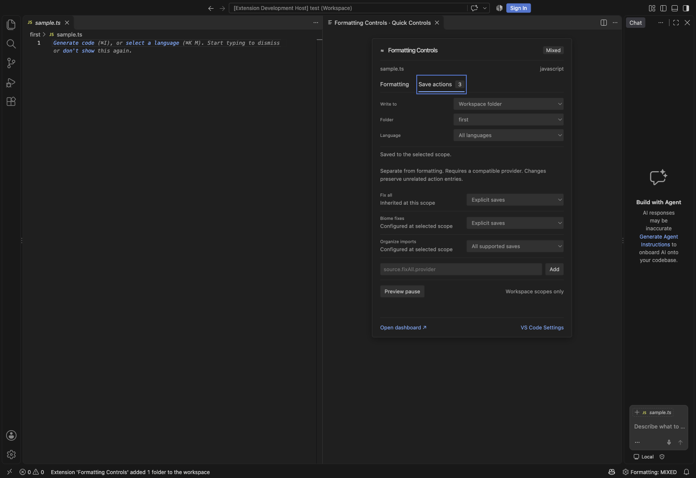
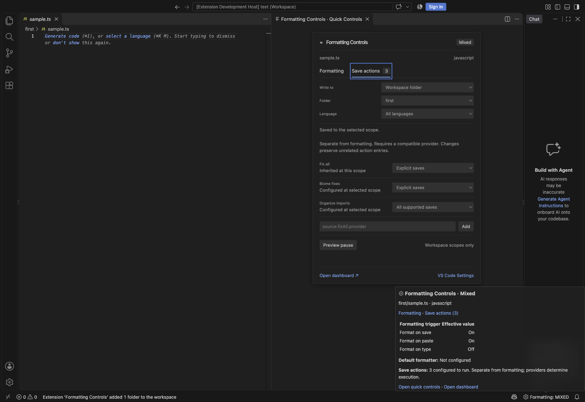

# Status hover and Quick Controls

The status-bar item now shows a rich native Markdown hover with the active editor, effective Save/Paste/Type flags, configured formatter and independent save-action count. Formatting and Save actions links open the corresponding tab in Quick Controls. Only navigation commands are trusted in the hover; file names, language IDs and formatter IDs are escaped, and raw HTML is disabled. Hovering never writes settings or runs providers.

Clicking the status item opens a compact, theme-aware Quick Controls panel beside the editor. It follows the approved tabbed structure and compact setting rows. VS Code's stable extension API does not expose Copilot's interactive HTML status popover, pointer placement or an arbitrary anchored webview. The implementation uses a native hover and an editor panel; it does not inject workbench DOM, patch VS Code, use internal commands or draw a misleading anchored pointer.

## Actual editor views

## Editing

The first opening selects the active file's workspace folder, otherwise Workspace, or User in an empty window. Later openings preserve the selected scope. Folder and Language remain explicit. Formatting checkboxes show the selected scope's owned value when present, otherwise the effective inherited value; a higher-priority effective value is shown separately when it differs. The header and status bar continue to summarize effective formatting.

Save actions have their own tab. Existing provider-specific entries remain visible; generic fix-all/import actions and a validated custom action ID can be configured without replacing unrelated entries. Legacy or malformed action containers must be migrated in VS Code Settings first. Configured actions do not guarantee provider eligibility, execution order or afterDelay Auto Save execution.

Preview pause and Resume / restore use the existing native preview, confirmation and conditional recovery journal. User-wide pause remains unavailable. Conflicts can be reviewed in the full dashboard. Full formatter selection, per-setting resets, diagnostics, profile management and deeper configuration evidence remain in the dashboard or native controls.

The compact panel uses the dashboard's existing validated message protocol, scoped revision checks, serialized requests and window/folder refresh behavior. The two surfaces share the same locally bundled React assets and nonce-based CSP. No scripts, styles or fonts are fetched from the network. Editor context is retained when the compact panel takes focus. User-scope behavior in remote sessions is explained in the panel.

## Commands and compatibility

- Formatting Controls: Quick Controls opens the compact panel.
- Formatting Controls: Native Quick Controls retains the original picker workflow and command ID `formattingControls.open`.
- Open Dashboard remains available from both the hover and compact panel.

The compact panel uses stable APIs supported by the existing VS Code 1.140 minimum. It works without a workspace, while Workspace/Folder editing remains disabled there. Run `bun run test:ui` for the full dashboard and `bun run test/run-integration.ts --quick-ui` after building for the compact panel. CI scans both tabs at wide/narrow sizes in all three existing accessibility themes and exercises real edits, keyboard navigation and the native hover. Automated scans do not replace the outstanding screen-reader review.
