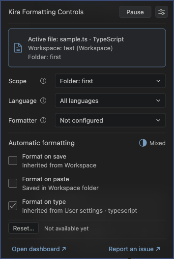

# Formatting status card

Hover and click open the same anchored card above the Formatting status-bar item. Click focuses and pins it; Escape dismisses it. Enter on the focused status item opens it. A normal status click creates neither a docked Panel view nor an editor tab.

The padded header shows **Kira Formatting Controls**, then the fixed-width blue Pause/Resume button with approximately 12px of space above and below, an 8px gap and an approximately 11.2px three-slider Settings icon inside a fixed 26px by 24px box. Version details remain in the Extensions listing. The app icon appears in that listing; the card has no app logo. The package ID remains `rajudhami.formatting-controls`.

## Read-only formatting summary

Both information icons share the same 11px vector shape. The file-context icon is blue, the formatting icon is gray, and each is vertically centered. The formatting icon sits approximately 8px from its label, with a 1px optical downward adjustment to align with the visible heading text.

- The file/workspace box identifies the editor whose effective settings are shown. Multi-root workspaces also name its folder.
- **Write to** and **Apply to language** identify the selected destination, rather than changing the file's language mode. Use the dashboard or optional Quick Controls command to change them.
- **Automatic formatting** is always visible. Its plain, muted, right-aligned status text reports **Enabled** when all three triggers are enabled, **Disabled** when none are enabled, or **Mixed** when they differ. A pause record does not replace this truthful effective-state label.
- Checkboxes show effective Save/Paste/Type settings without redundant Enabled/Disabled text. Source notes distinguish saved values, inherited settings and defaults. Checkbox and dropdown displays are read-only and open no picker.
- The default formatter is shown below the three settings.
- The footer provides **Open dashboard ↗** and **Report an issue ↗**. Issue reporting opens [this repository's new-issue form](https://github.com/kira-explore/formatting-controls/issues/new); it does not submit an issue or upload diagnostics automatically.

The complete file box and Automatic formatting summary row have stable explanatory hover text on their images. Neither row is a link or a keyboard focus target. Clicking them does not invoke a command, show a link focus outline, open a notification, change settings or rebuild the card. Dynamic values remain in the card rather than changing the help text. File help reads “This summary is based on the active file.” followed by “Settings may differ by language or workspace folder.” Formatting help starts with “Automatic formatting settings for save, paste and type.” and has separate numbered lines: Enabled means all three are on; Disabled means all three are off; Mixed means some are on and others are off. Settings retains a descriptive hover title. The transparent blue borderless footer buttons identify their destinations on hover. Pause/Resume explains its current action on hover; its separate caption row has been removed. Long visible labels are shortened while full values remain in image alternatives.

## Manual Pause/Resume

At a workspace/folder destination, **Pause** opens a native picker to confirm disabling only Save/Paste/Type. The header button’s tooltip is **Pause automatic formatting until you resume.** The Command Palette command **Formatting Controls: Pause / Resume Automatic Formatting** opens the same flow.

The card closes before the picker opens, and the status-bar item is immediately restored. Choose the displayed action to continue, or press Escape to cancel without changing settings or recovery data. Repeated requests while the picker or operation is active are ignored. Changes to the editor/settings or restore point while choosing invalidate the pending action.

Settings are updated after confirmation with the hover dismissed. The tooltip is restored after cancellation, completion or error, without automatically reopening it. There is no intermediate Pausing/Resuming artwork or artificial animation delay. Reopening the card shows the completed result in the same layout, avoiding native whole-card fade restarts during an inline toggle.

After successful application, the reopened card shows **Resume**, with the tooltip **Restore your previous formatting settings.** Resume uses the same native picker and restores unchanged pre-pause preferences while preserving newer edits; it does not enable every trigger automatically. After complete restoration the button and its tooltip return to Pause.

Durable recovery and rollback remain in place. A failure before settings change retains the original label and configuration; an incomplete operation retains its recovery record. If restoration preserves conflicting external edits, Resume remains available and Profiles can review or keep those values. Already-disabled formatting still records a durable pause, so Pause/Resume remains a consistent pair. The status card's formatting-only pause leaves save actions and formatter selection unchanged; resuming a pause created in Profiles restores that record's unchanged values. No timer or automatic resumption is introduced.

Before changing project settings, the extension checks whether the destination settings document has unsaved edits. It stops before preparing or changing the recovery record and shows a warning with **Open settings file**. Save or resolve those edits yourself, then retry. Workspace settings in a multi-root workspace use the workspace file; folder settings use that folder’s `.vscode/settings.json`. Unrelated dirty documents do not block the operation. The extension never saves or discards edits automatically. Each write also rechecks the document; an intervening edit can still interrupt a batch and retain recovery. A blocked Resume keeps its record and Resume label.

Dashboard/profile workflows and the Restore Previous Settings command retain their existing previews and confirmations. Status-card and Command Palette Resume is restricted to project pause records; it cannot silently restore a saved profile.

## Rendering and compatibility

Read-only dropdowns use standard outlined fields with normal text and arrows. Checkboxes use neutral outlines and ticks rather than a disabled gray fill. Footer actions retain transparent, borderless 28px hit areas. Blue labels and external arrows have no underline. Each complete button, including its horizontal padding, is linked and uses the hand cursor. The gap between them is unlinked artwork, so it neither shows an action cursor nor opens the dashboard. Separate image alignment preserves the footer's vertical spacing.

VS Code's public `StatusBarItem.tooltip` accepts Markdown, images and command links; arbitrary form styling is sanitized. Locally generated inert SVG images preserve the approved layout, with native links for actions and hover-only titles for help. No scripts, external images, rendering network calls or rendering files are used.

The approved compact layout uses a 380px content width (approximately 404px including the native hover frame and insets). The title and section heading use 13.5px regular text and body/control text 12.5px, including source notes, button labels and footer links. Icons, 17px checkboxes and dropdown arrows are reduced to match. Read-only fields retain 28px outlines. The status reserves 78px of width with no border or background, so labels do not move neighboring content. Setting rows use a 46px rhythm with approximately 10px between each checkbox and its text. Checked boxes show an outlined tick; unchecked boxes retain the same neutral surface. High-contrast themes retain distinct ticks and outlines. The file/workspace block and context info icon are vertically centered, with a 14px gap between the icon and text. The formatting heading, info glyph and fixed-width status text share one hover-only image with an optical adjustment for the icon, rather than mixing a text baseline with icon coordinates. The status explanation remains discoverable through the visible info icon. The blue filled Pause/Resume button uses white text, matching the reference Upgrade button’s appearance while retaining the native pause picker flow. Its 62px by 24px dimensions remain fixed across both labels and match the Settings button’s height; a read-only User-scope display keeps neutral styling. Borderless footer artwork shares the same content width and aligns to the card edges independently of VS Code's native table-column sizing. Its 139px and 133px button widths leave a 108px unlinked gutter.

Transparent artwork reveals the native hover surface. Dark, light, high-contrast and high-contrast-light palettes follow the theme kind; arbitrary custom theme colors/fonts are not available inside the image renderer. Native links follow the editor's own hover/focus styling. The public Markdown tooltip cannot reproduce Copilot's custom grey icon-button hover fill or enforce a custom hover underline. This limitation does not change layout or actions.

VS Code controls the outer frame, pointer and hover delay. Its Markdown sanitizer does not allow custom cursor CSS; read-only checkbox/dropdown images keep the host's normal cursor. Header and footer actions use the native hand cursor. Both information areas retain the host’s normal image cursor because they are not clickable links. Explicit image dimensions reserve space while images load. Click-to-focus uses the built-in `workbench.action.showHover` command, checked on minimum and current editor versions; this is a compatibility dependency rather than a dedicated public status-item pinning API.

Sources: [StatusBarItem](https://code.visualstudio.com/api/references/vscode-api#StatusBarItem), [Markdown input handling](https://github.com/microsoft/vscode/blob/1.143.1/src/vs/base/browser/markdownRenderer.ts).

## Safety

Pause command links carry a revision. Changes to settings/editor context invalidate stale actions; equivalent notifications retain the active tooltip/revision. Setting workflows are serialized. XML/HTML text is escaped, command URIs are allowlisted and the issue URL is fixed.

The separate dashboard retains its validated message protocol and nonce-based content security policy. **Formatting Controls: Quick Controls** keeps its formatting-only native picker; **Native Quick Controls** keeps the full settings picker. No command opens a docked Formatting Controls view.
