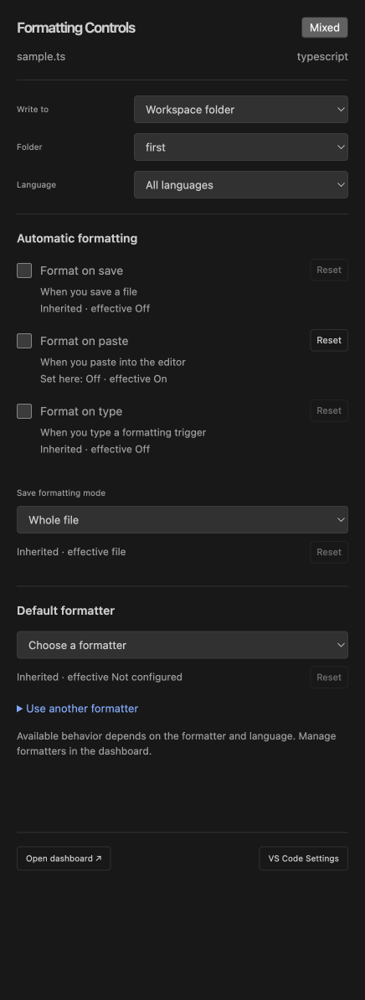

# Formatting sidebar

Clicking the Formatting status item opens a real interactive card in the sidebar without adding an editor tab. The Activity Bar icon and **Formatting Controls: Open Sidebar Controls** command open the same view. This replaces the earlier compact editor panel and native-hover editing links.

The card contains:

- User/Workspace/Folder write scope, explicit folder selection and language dropdowns.
- Save/Paste/Type checkboxes with owned, effective and inherited-value notes.
- Save formatting mode, installed formatter selection and a custom formatter-ID input with an Apply button.
- Per-setting Reset buttons using the existing native confirmation and stale-preview protection.
- Dashboard and VS Code Settings buttons, inline errors and saving feedback.

Save actions, provider management, profiles and pause/recovery remain in the full dashboard. Installed formatter choices do not guarantee language support or provider execution.

## Scope and context

The first opening selects the active file’s workspace folder, otherwise Workspace, or User in an empty window. Later openings preserve the selected scope. The editor’s context is captured before focusing the sidebar and follows editor/language changes while the view is connected. Folder and language remain explicit; removing a folder reconciles the selection to User. Closing a document no longer leaves its closed context in snapshots, and changing language mode refreshes the live context.

Controls show their selected scope’s owned value when present, otherwise the effective inherited value. A differing effective value is displayed separately. Each edit writes only to the selected scope; a higher-priority language override can continue to control the editor. Reset removes the owned value after confirmation, allowing inherited values to apply. User settings in remote windows follow VS Code’s remote configuration behavior; the card explains that Workspace/Folder settings keep changes in the project.

## Appearance and placement

The sidebar uses native HTML checkboxes, selects, inputs and buttons styled with VS Code theme tokens. Its width follows the resizable VS Code sidebar; drag the divider to widen it. The card fills that width up to 520px and adapts to narrower layouts. VS Code’s view controls can move it to another sidebar location.

Hovering the status item shows a read-only native Markdown summary with sidebar/dashboard links. It does not edit settings or run a formatter. VS Code controls hover appearance and delay. Real form inputs require a webview, so the interactive card lives in the sidebar rather than the anchored hover. The extension does not patch VS Code or inject workbench UI.

## Implementation and verification

The dashboard controller now mounts its existing validated protocol into either a panel or a WebviewView. Each surface has an independent scope/revision state and the same serialized requests, folder allowlists, language validation, stale-write checks and conditional reset behavior. The sidebar uses locally bundled assets, nonce-only script CSP and restricted resource roots. Hidden view reconstruction keeps the host’s scope instead of replacing it with the webview’s initial User request. Disposal clears listeners and prevents pending snapshots from posting into another surface.

After building, run `bun run test/run-integration.ts --status-ui` for actual status-click/sidebar UI checks. It uses a fresh test profile and real sidebar resizing for wide/narrow scans. VS Code refuses modal dialogs in extension-test mode; Reset cancellation/confirmation was additionally verified in a normal development window, with unrelated save-action settings preserved. `bun run test:ui` continues to cover the full dashboard. CI runs both surfaces in Dark Modern, Light Modern and Default High Contrast, in addition to the existing editor/platform and remote checks. Automated scans do not replace the outstanding screen-reader review.

The command ID `formattingControls.quickControls` remains compatible and now opens the sidebar. `formattingControls.open` retains the original Native Quick Controls pickers.
