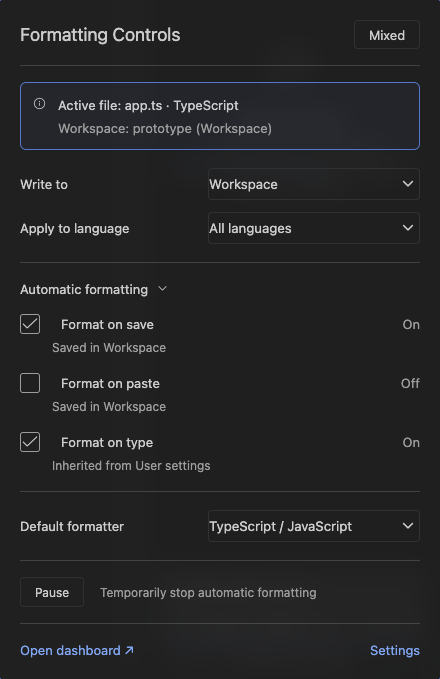
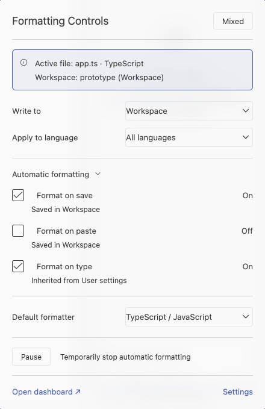
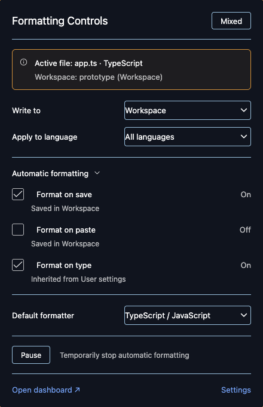

# Interactive status-bar core prototype

This implements the approved Formatting Controls card inside a custom VS Code build: hover and click use the same anchored surface, with actual VS Code Checkbox and SelectBox components. Clicking pins/focuses the card. No docked view, sidebar or editor tab is created for the card. The existing dashboard remains separate.

**This requires the patched editor. Installing the VSIX into ordinary VS Code does not enable this UI.** The public extension tooltip API cannot host these inputs. The extension retains its existing Markdown controls as a compatibility fallback when the private core handshake is absent.



## Included behavior

- Formatting Controls title without an app icon, outlined effective On/Off/Mixed state and a header separator.
- Blue outlined active-file/language/workspace context; multi-root workspaces also identify the active folder. The relative path is available on hover.
- Inline native dropdowns for User/Workspace/active workspace folder, registered language rules and default formatter. macOS uses native menus; other platforms use VS Code's SelectBox implementation. No QuickPick is used for those dropdowns.
- Real checkboxes for Save, Paste and Type, effective On/Off text, accurate saved/inherited/override sources and a collapsible section. Checkboxes edit the selected scope's value; the effective state can differ when another scope wins.
- Reviewed formatting-only Pause/Resume, preserving save actions and newer edits. Pause is restricted to workspace/folder scopes. Its existing JSON preview and confirmation intentionally open before settings are written.
- Separate Open dashboard and Settings footer actions. The approved app icon remains in the Extensions listing only.

The formatter list uses installed, language-compatible adapters and includes a currently configured formatter without an adapter. Selecting it configures VS Code; availability of a formatter provider still depends on the extension. Choosing the inherited entry removes only the selected scope's formatter override.

## Build and run

Use Node 24 LTS and Bun 1.4.4 for this project. The isolated upstream checkout uses its own pinned npm dependency graph and upstream build scripts; those dependencies do not become dependencies of the Marketplace extension.

VS Code base: **1.143.1**, commit **e646868227c3e3a9e3f24277c8c7220be42c0be7**. The apply script refuses other revisions and unrelated source edits. It adds the contribution, its protocol/configuration and one workbench import, plus a small internal status-entry hover option that enables the editor's own pointer for this card. Existing entries retain their defaults. Subsequent overlay updates are allowed only when the previous overlay's hashes still match. Use a separate source checkout; never patch an installed app.

```sh
# From the formatting-controls repository:
bun install --frozen-lockfile
bun run build

# Choose a new, isolated sibling directory:
git clone --depth 1 --branch 1.143.1 https://github.com/microsoft/vscode.git ../vscode-formatting-prototype
bun run prototype:apply ../vscode-formatting-prototype
bun run prototype:check ../vscode-formatting-prototype

cd ../vscode-formatting-prototype
npm run install-fast
npm run build-fast
npm run electron
node_modules/.bin/tsc --project src/tsconfig.kira-formatting.json --noEmit

# Use the actual absolute extension repository and demo workspace paths:
VSCODE_SKIP_PRELAUNCH=1 ./scripts/code.sh /path/to/demo.code-workspace \
  --extensionDevelopmentPath=/path/to/formatting-controls \
  --user-data-dir=/path/to/isolated-prototype-user \
  --extensions-dir=/path/to/isolated-prototype-extensions \
  --disable-workspace-trust --skip-welcome --skip-release-notes
```

The source build also runs without `VSCODE_SKIP_PRELAUNCH`; VS Code then manages its normal pre-launch checks. The explicit skip above uses the outputs built in the preceding steps. The macOS test runner uses `scripts/code.sh`; the contribution itself uses VS Code's platform abstractions.

## Verify

```sh
# From the formatting-controls repository, after building the patched editor:
bun run test:core-prototype ../vscode-formatting-prototype
FORMATTING_CONTROLS_UI_THEME='Light Modern' bun run test/core-prototype.ts ../vscode-formatting-prototype
FORMATTING_CONTROLS_UI_THEME='Default High Contrast' bun run test/core-prototype.ts ../vscode-formatting-prototype

# Regenerate the reviewable patch from an applied checkout:
bun run prototype:patch ../vscode-formatting-prototype
```

Tests run against a temporary workspace, user profile and extensions directory. The real-editor harness checks theme application, single status entry, cold click/pinning, hover/click position parity, three checkboxes, three native dropdowns on macOS, stable repeated toggles, inline scope/language/formatter changes, disclosure, reviewed Pause/Resume, keyboard access, dashboard navigation, stale revisions/sessions and save-action preservation. Axe scans the actual card in each tested theme. Screenshots and logs are written to `test-results/core-prototype/`.




## Private bridge and limitations

The core contribution registers `kiraFormattingControls.prototype.connect`, `update` and `disconnect`. The extension supplies validated snapshots and handles a constrained action union via `formattingControls.core.snapshot` and `formattingControls.core.action`. Session and revision checks reject stale editor/settings actions. Existing configuration and recovery code remains responsible for writes. The core renders labels with textContent and native option text, never untrusted HTML. Controls are updated in place instead of rebuilding the hover after each change.

The core implementation uses the internal `IStatusbarService` and `ToggleTooltipCommand`, which are also used by Copilot's status card. It is a prototype for a custom editor, not a proposed or public VS Code extension API. Hover timing, outer placement and dismissal follow the editor's native hover service. No installed editor files, global Node configuration or user's existing workspaces are modified by the apply script or tests. Runtime UI validation currently covers macOS; stock-editor compatibility continues through the existing cross-platform CI suite.

The portable [core patch](vscode-1.143.1.patch) and source overlays are MIT licensed. Upstream VS Code and its licenses remain in the separate checkout.
